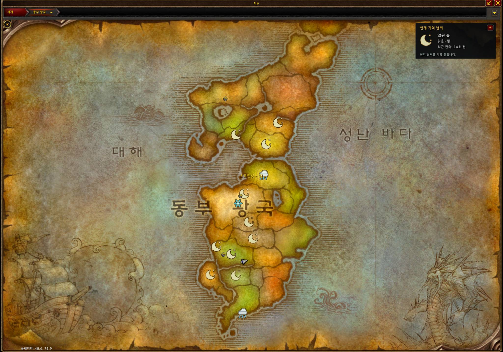
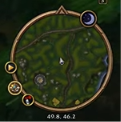
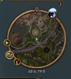

# WACHEONUI — Azeroth Weather Observatory

**Observe the skies. Share the weather. Discover Azeroth.**

**와천의(觀天儀)** — 하늘의 비밀을 풀고, 다가올 날씨를 예측하다.

WACHEONUI is a community-driven weather observation and information-sharing addon for **World of Warcraft: Forever**.

Developed by **Yame92**, WACHEONUI helps players observe, record, and share weather conditions across Azeroth.

---

## Features

- **Weather Observation** — Displays observed weather conditions on world and zone maps.
- **Community Weather Sharing** — Exchanges weather observations between compatible addon users.
- **Phase-Aware Observations** — Supports weather information associated with different game phases.
- **Minimap Weather Indicators** — Provides convenient weather information near the minimap.
- **Manual Weather Reporting** — Allows players to record and report unusual weather conditions.
- **Customizable Interface** — Includes configurable weather panels and display settings.
- **Korean and English UI** — Automatic interface localization based on the game client language (English support under testing).

## Screenshots

### World Map Weather Observation
View observed weather conditions across Azeroth directly on the world map.

### Dynamic Minimap Weather Effects
The minimap weather display changes according to the weather conditions in the surrounding area.

**Normal Weather**

**Weather Effect Active**

### Additional Preview

    
## Download & Installation

**[Download WACHEONUI on CurseForge](https://www.curseforge.com/wow/addons/wacheonui-azeroth-weather-observatory)**

1. Download the latest compatible release from CurseForge.
2. Install the addon using CurseForge or extract it into your World of Warcraft AddOns directory.
3. Enable WACHEONUI in the game's addon list.
4. Open your world map to explore the weather observation interface.

## How It Works

WACHEONUI collects weather observations available through the game client and displays them on the map.

Players can share compatible observation data with other WACHEONUI users to help build a broader picture of weather conditions across Azeroth.

Weather information may vary by location, phase, and observation time. Reports should not be interpreted as guaranteed weather forecasts.

## Language Support

- Korean (`koKR`) — Primary language
- English (`enUS`) — UI localization under testing
- Other client locales — English fallback where translations are available

## Feedback & Bug Reports

Found an issue or an incorrect weather observation?

Please use [GitHub Issues](https://github.com/Yame92/WACHEONUI-Addon/issues) to report bugs, unexpected behavior, or suggestions.

When reporting a problem, please include the addon version, game client build, affected zone, and reproduction steps where possible.

---

## 한국어 소개

**와천의(WACHEONUI)** 는 월드 오브 워크래프트: 포에버의 날씨를 관측하고, 지도에 표시하며, 이용자들과 관측 정보를 공유하는 애드온입니다.

### 주요 기능

- 세계지도 및 지역지도 날씨 관측 정보 표시
- 애드온 이용자 간 날씨 관측 정보 공유
- 위상별 날씨 관측 정보 구분
- 미니맵 날씨 표시
- 새로운 날씨 수동 기록 및 제보
- 지도 패널 및 UI 사용자 설정
- 한국어·영어 UI 지원 (영어 번역 테스트 중)

### 다운로드

[CurseForge 와천의 다운로드](https://www.curseforge.com/wow/addons/wacheonui-azeroth-weather-observatory)

### 개발 목적

아제로스의 다양한 기상 현상을 기록하고, 여러 이용자의 관측 정보를 공유하여 더욱 풍부한 날씨 정보를 제공하는 것이 와천의의 목표입니다.

---

## Developer

**Yame92 (야매92)**

- GitHub: [@Yame92](https://github.com/Yame92)
- YouTube: [야매92](https://www.youtube.com/@yame9292)
- Addon: [WACHEONUI on CurseForge](https://www.curseforge.com/wow/addons/wacheonui-azeroth-weather-observatory)

## License & Usage

**All Rights Reserved.**

WACHEONUI is distributed for use as a World of Warcraft addon.

Public access to this repository does not grant permission to copy, modify, redistribute, or incorporate protected project materials into other projects without authorization from the relevant rights holder.

Third-party materials and AI-generated assets, where applicable, may be subject to different rights and protections.

© 2026 Yame92. All rights reserved to the extent permitted by applicable law.
